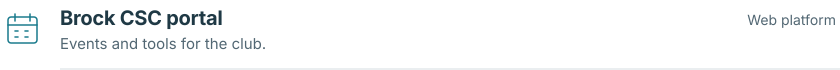
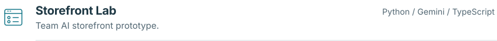
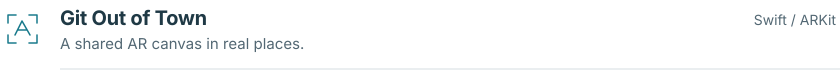
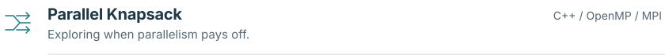

<picture>
  <source media="(max-width: 600px) and (prefers-color-scheme: dark)" srcset="assets/identity-narrow-dark.svg">
  <source media="(max-width: 600px)" srcset="assets/identity-narrow.svg">
  <source media="(prefers-color-scheme: dark)" srcset="assets/identity-dark.svg">
  
</picture>

 I'm interested in software engineering across product features, backend systems, and automation.

 I also want to build AI into useful products. Enterprise-scale work appeals to me because small improvements can make a lot of people's work easier.

### Selected work

<a href="https://github.com/BrockCSC/website">
<picture>
  <source media="(max-width: 600px) and (prefers-color-scheme: dark)" srcset="assets/project-csc-narrow-dark.svg">
  <source media="(max-width: 600px)" srcset="assets/project-csc-narrow.svg">
  <source media="(prefers-color-scheme: dark)" srcset="assets/project-csc-dark.svg">
  
</picture>
</a>

<a href="https://github.com/AlaqmarG/storefront-lab">
<picture>
  <source media="(max-width: 600px) and (prefers-color-scheme: dark)" srcset="assets/project-halt-narrow-dark.svg">
  <source media="(max-width: 600px)" srcset="assets/project-halt-narrow.svg">
  <source media="(prefers-color-scheme: dark)" srcset="assets/project-halt-dark.svg">
  
</picture>
</a>

<a href="https://github.com/AlaqmarG/git-out-of-town">
<picture>
  <source media="(max-width: 600px) and (prefers-color-scheme: dark)" srcset="assets/project-ar-narrow-dark.svg">
  <source media="(max-width: 600px)" srcset="assets/project-ar-narrow.svg">
  <source media="(prefers-color-scheme: dark)" srcset="assets/project-ar-dark.svg">
  
</picture>
</a>

<a href="https://github.com/AlaqmarG/parallel-knapsack">
<picture>
  <source media="(max-width: 600px) and (prefers-color-scheme: dark)" srcset="assets/project-optisack-narrow-dark.svg">
  <source media="(max-width: 600px)" srcset="assets/project-optisack-narrow.svg">
  <source media="(prefers-color-scheme: dark)" srcset="assets/project-optisack-dark.svg">
  
</picture>
</a>

I spent a good while making games, and I still love playing them. Away from code, you'll also find me on the controlling side of the radio.

<picture>
  <source media="(max-width: 600px) and (prefers-color-scheme: dark)" srcset="assets/off-clock-narrow-dark.svg">
  <source media="(max-width: 600px)" srcset="assets/off-clock-narrow.svg">
  <source media="(prefers-color-scheme: dark)" srcset="assets/off-clock-dark.svg">
  
</picture>

[LinkedIn](https://www.linkedin.com/in/alaqmarg/) · [Email](mailto:alaqmargandhi@gmail.com)
